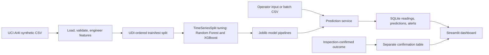

# Predictive Maintenance & Equipment Failure Forecasting

A portfolio project that compares Random Forest and XGBoost classifiers and presents model estimates through a Streamlit operations dashboard backed by SQLite.

> **Data and model scope:** The AI4I 2020 benchmark is synthetic. It has temperature, rotational speed, torque, tool wear, product type, and failure labels, but no vibration or pressure readings. The model estimates the failure label for a recorded operating point; the dataset does not define a future prediction horizon or remaining-useful-life target. Predictions are advisory and are stored separately from inspection-confirmed outcomes.

## Project status

- Random Forest and XGBoost have been tuned and evaluated on a chronological holdout.
- The selected baseline is Random Forest, chosen by training-only time-series cross-validation F1.
- The held-out test scores do **not** meet the requested 90% precision, 85% recall, and 87% F1 goals. See [the model comparison report](reports/model_comparison.md).
- Both tuned pipelines and the selected inference bundle are saved under `models/`; the dashboard loads `models/model.joblib`.
- The Streamlit app includes six pages, single and batch prediction, SQLite history, alerts, and separate actual-outcome recording.

## Architecture



See [the architecture notes](docs/architecture.md) for module responsibilities and data flow.

## Repository layout

```text
data/ai4i2020.csv                 source dataset
data/processed/                  generated train/test splits (local)
models/                          tuned models and model.joblib
notebooks/01_eda.ipynb           interactive exploratory analysis
reports/                         metrics.json, summaries, and figures
src/data.py                      shared dataset and feature helpers
src/download_data.py             download and validate the UCI CSV
src/train.py                     train both models and package the winner
src/predictive_maintenance/      reusable preprocessing, inference, and SQL code
app.py                           Streamlit entry point
scripts/                         detailed reproducible workflow commands
sql/                             SQLite schema
docs/ and tests/                 guides, reports, and workflow tests
```

## Dataset and attribution

The project uses the [AI4I 2020 Predictive Maintenance Dataset from UCI](https://archive.ics.uci.edu/dataset/601/ai4i), distributed under CC BY 4.0. UCI describes it as a synthetic 10,000-row benchmark. The source CSV is staged at `data/ai4i2020.csv`; its provenance and limitations are recorded in [data/README.md](data/README.md).

Citation: Matzka, S. (2020). *AI4I 2020 Predictive Maintenance Dataset*. UCI Machine Learning Repository. https://doi.org/10.24432/C5HS5C.

## Setup (Windows PowerShell)

Use Python 3.12 or 3.13. From the project root:

1. Create and activate an environment: `python -m venv .venv`, then `\.venv\Scripts\Activate.ps1`.
2. Install packages: `python -m pip install -r requirements.txt`.
3. Install the local package in editable mode: `python -m pip install -e .`.
4. In VS Code, select `.venv\Scripts\python.exe` using **Python: Select Interpreter**.

The checked-in `requirements.txt` pins the direct dependency versions used for the current model run. This helps keep the saved scikit-learn/XGBoost artifacts compatible across local and hosted environments.

## Run the project

From the root directory, run the preparation and model commands in order:

- `python src/download_data.py` — download the dataset if `data/ai4i2020.csv` is missing.
- `python scripts/inspect_dataset.py` — inspect the source file and label distribution.
- `python scripts/prepare_data.py` — clean, engineer, split, and encode features. This saves `data/processed/train.csv`, `data/processed/test.csv`, and `models/preprocessor.joblib`.
- `python scripts/run_eda.py` — generate EDA charts and `reports/eda_summary.md`.
- `python src/train.py` — tune and evaluate both classifiers, save `reports/metrics.json`, and package the selected pipeline as `models/model.joblib`.
- Or run `python scripts/train_models.py` and `python scripts/package_model.py` separately for the detailed steps.
- `python scripts/init_database.py` — create the local SQLite schema.
- `python scripts/seed_demo_data.py` — optionally add clearly labeled synthetic examples for screenshots and UI exploration.
- `streamlit run app.py` — launch the dashboard.

The app initializes SQLite automatically if the database file is absent. The database file is local and ignored by Git; the SQL schema is tracked at `sql/schema.sql`.

## Dashboard pages

1. **Home Dashboard** — equipment counts, latest predicted risk, open alerts, and separately logged confirmations.
2. **Equipment Monitoring** — register equipment, review readings, and record inspection-confirmed outcomes.
3. **Failure Prediction** — score one reading or upload a batch CSV; download results.
4. **Model Performance** — compare cross-validation and held-out metrics, parameters, and confusion matrix.
5. **Maintenance Alerts** — view, acknowledge, and resolve model-generated alerts.
6. **Historical Data and Analytics** — inspect reading and prediction history and download it.

## Dashboard screenshots

| Page | Screenshot |
|---|---|
| Home Dashboard | [Open screenshot](docs/screenshots/home_dashboard.png) |
| Equipment Monitoring | [Open screenshot](docs/screenshots/equipment_monitoring.png) |
| Failure Prediction | [Open screenshot](docs/screenshots/failure_prediction.png) |
| Model Performance | [Open screenshot](docs/screenshots/model_performance.png) |
| Maintenance Alerts | [Open screenshot](docs/screenshots/maintenance_alerts.png) |
| Historical Data and Analytics | [Open screenshot](docs/screenshots/historical_analytics.png) |

Single and batch model inputs must include these columns:

`Type`, `Air temperature [K]`, `Process temperature [K]`, `Rotational speed [rpm]`, `Torque [Nm]`, `Tool wear [min]`.

The single-entry form and batch CSV may also include optional `vibration` and `pressure` readings. They are stored for history and analytics but do not affect the model score because AI4I has no vibration or pressure training features.

An optional `equipment_code` column lets batch predictions be written to equipment history. Do not include `Machine failure` or failure-mode labels in inference CSVs.

## Model evaluation

The first 80% of UDI-ordered records were used for training and four-fold `TimeSeriesSplit` tuning. The final 20% were held out for one evaluation. Preprocessing is fitted inside each cross-validation fold.

| Model | Test accuracy | Test precision | Test recall | Test F1 | Test ROC-AUC |
|---|---:|---:|---:|---:|---:|
| Random Forest | 0.9885 | 0.7222 | 0.6667 | 0.6933 | 0.9549 |
| XGBoost | 0.9875 | 0.6667 | 0.7179 | 0.6914 | 0.9550 |

The holdout contains 39 failures, so recall estimates are sensitive to individual records. Accuracy is high partly because failures are uncommon. Full metrics and confusion matrices are in [reports/model_comparison.md](reports/model_comparison.md) and [reports/metrics.json](reports/metrics.json).

## Database and confirmed outcomes

SQLite stores equipment, sensor readings, model predictions, maintenance alerts, and inspection-confirmed outcomes in separate tables. A `predicted_failure` value is never written as a confirmed outcome. See [sql/schema.sql](sql/schema.sql) and [the user guide](docs/user_guide.md).

## Deployment

The public repository is [divyansh5154/predictive-maintenance-equipment-failure-forecasting](https://github.com/divyansh5154/predictive-maintenance-equipment-failure-forecasting). To publish the live dashboard, sign in to [Streamlit Community Cloud](https://share.streamlit.io/), choose **Create app**, and select this repository, branch `main`, and entrypoint `app.py`. The app's dependencies and dark theme are configured at the repository root. See [the deployment guide](docs/deployment.md) for the exact steps.

Community Cloud does not guarantee persistence for local files, so its local SQLite database may be deleted. This is suitable for a portfolio demo with disposable records. Connect a managed database for durable hosted records. [Streamlit data persistence note](https://docs.streamlit.io/develop/concepts/connections/connecting-to-data)

Detailed steps are in [docs/deployment.md](docs/deployment.md).

## Limitations

- AI4I is synthetic; held-out benchmark scores do not prove performance on real equipment.
- Pressure and vibration are not in the dataset or model.
- There is no explicit forecast horizon, so this model is not a remaining-useful-life predictor.
- Test-time risk bands are provisional; they are not calibrated safety thresholds.
- The Streamlit app scores operator-entered or uploaded readings; it does not connect directly to industrial sensors.
- Community Cloud local SQLite storage is not durable.

## Documentation

- [Architecture](docs/architecture.md)
- [Exploratory notebook](notebooks/01_eda.ipynb)
- [Model card and evaluation protocol](docs/model_card.md)
- [Dashboard user guide](docs/user_guide.md)
- [Deployment and GitHub instructions](docs/deployment.md)
- [Resume description and interview Q&A](docs/interview_prep.md)
- [EDA summary](reports/eda_summary.md)
