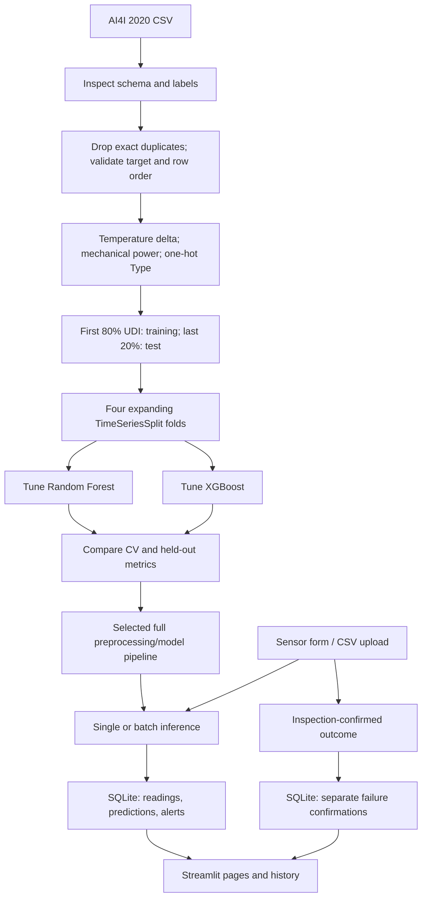

# Project architecture

## Data and model flow

## Module responsibilities

- `src/predictive_maintenance/data/preprocessing.py`: selects model inputs, engineers features, and builds an imputation/encoding transformer.
- `scripts/prepare_data.py`: validates the dataset, creates the chronological train/test files, fits the preprocessing object on training rows, and writes processed files.
- `scripts/train_models.py`: recreates the same split, fits preprocessing inside each CV fold, tunes both model families, evaluates the holdout, and saves model/metric artifacts.
- `scripts/package_model.py`: selects the training-CV winner and packages the complete pipeline plus inference metadata.
- `src/predictive_maintenance/inference/predictor.py`: validates new records, derives the same features, and returns probability, predicted label, risk band, and suggested action.
- `src/predictive_maintenance/database/repository.py`: owns SQLite connections and CRUD operations for assets, readings, predictions, alerts, and human confirmations.
- `app.py`: presents six pages and calls the inference and repository modules.

## Leakage controls

`UDI` determines row order only; it is not a model input. `Product ID`, `Machine failure`, and failure-mode outcome columns are also excluded from predictors. Cross-validation uses a pipeline so each fold fits its own imputer and encoder. The final test window is used only for evaluation.

## Prediction and actual outcome records

Every prediction is saved in `predictions` with its model name, probability, decision threshold, and risk band. An operator inspection is stored independently in `failure_confirmations`. The database and dashboard do not convert one into the other.
